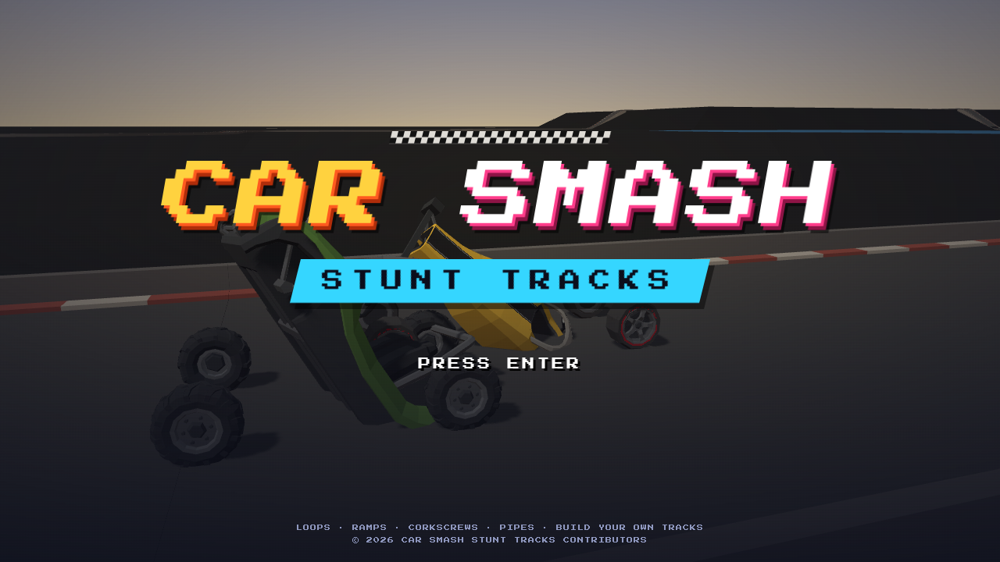
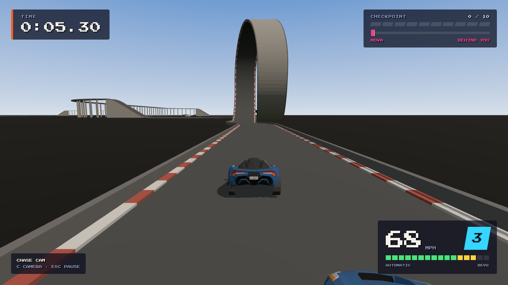
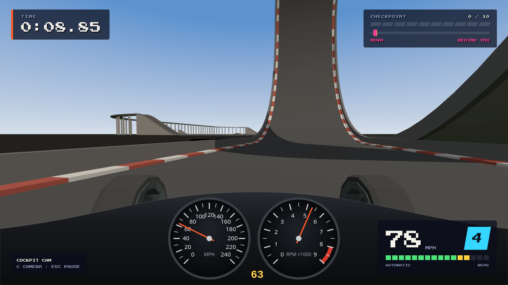
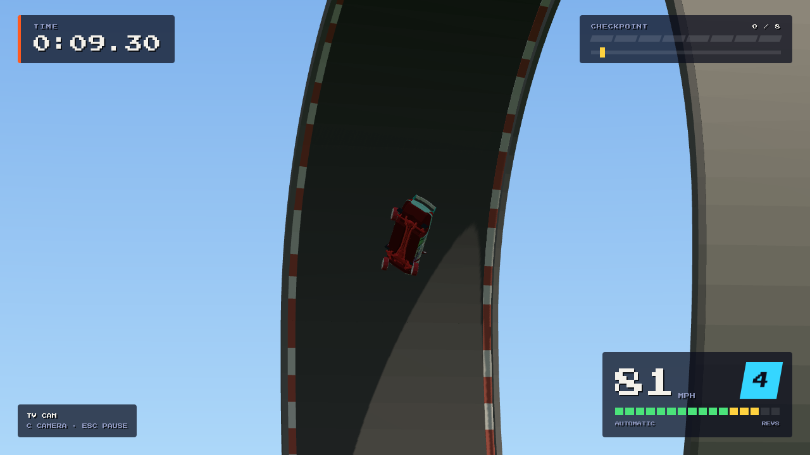
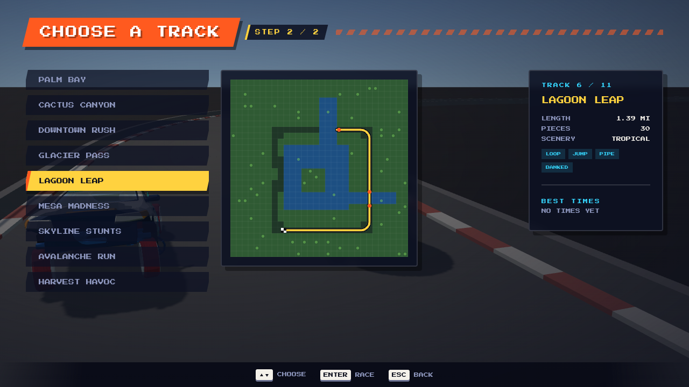
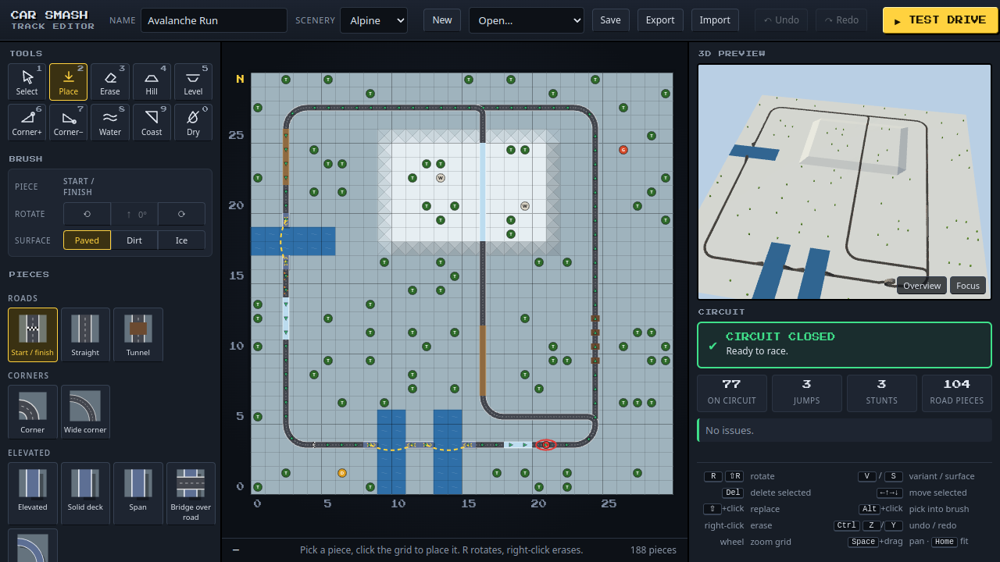
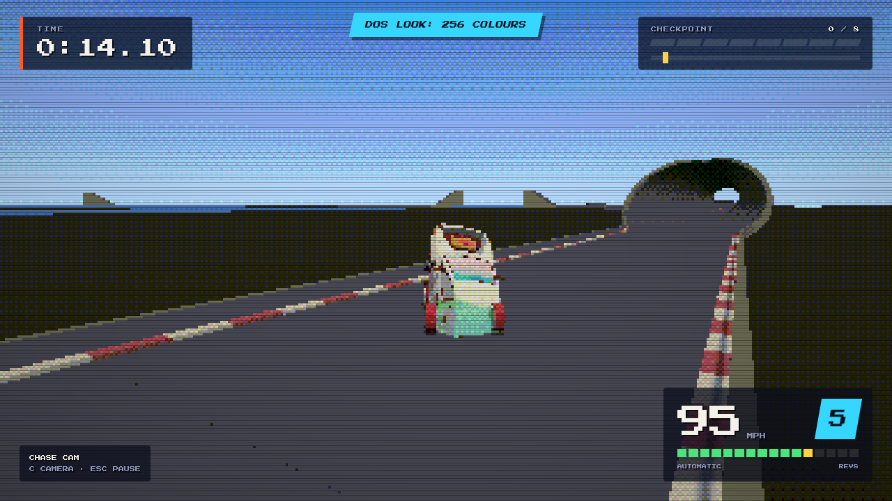
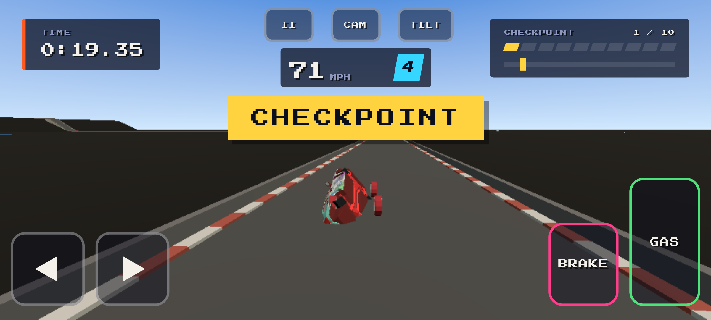

# Car Smash Stunt Tracks



A 3D stunt-track racer in the browser. Race a 30 × 30-tile track of loops, corkscrews, pipes, banked corners,
jumps, bridges and elevated roads, against the clock or a rival, from the chase cam or from behind the wheel; watch
the replay; then build your own track in the editor and test-drive it. It is built with three.js and TypeScript, its
models come from Synty assets through the Synty Sprite Generator, and its driving runs on a deterministic 20 Hz
simulation, so a race is fully defined by the track, the cars and your input.

## Features

- **Ten tracks** across five scenery sets (country, tropical, desert, city, alpine), from a gentle Sunday drive to
  two loops, a corkscrew roll, a pipe, a helix and a choice of routes — plus a plain test oval.
- **Stunts that drive like stunts**: loops and corkscrew rolls you drive upside down, pipes, a helix, banked
  corners, ramps and jumps, bridges, tunnels, dirt and ice; crash too hard and the car is put back on the road with a
  time penalty.
- **Eight cars** with their own gearing, torque, grip and weight, automatic or manual gearbox.
- **Six rivals**, each with their own car, skill and nerve, racing you on the same track (the two cars collide).
- **Cameras**: chase, in-car with a dashboard, track-side TV cameras and an orbit view.
- **Replays** of every race (they are just your input bytes), with VCR controls, saved in the browser.
- **High scores**: seven places per track, with your initials.
- **A track editor**: paint the terrain (hills, water, coast), place pieces from the palette, check that the
  circuit closes, see it in a live 3D preview, save, export / import JSON, and press Test drive.
- **The DOS look** (F2): 200 lines, a 256- or 16-colour palette and scanlines.
- **Phones and tablets**: on-screen pedals and steering (or tilt steering), tappable menus, and the editor with tap
  to place and two-finger pan / pinch zoom. Keyboard and gamepad work everywhere.
- **Synthesised music and sound**: FM tones and filtered noise, our own songs; `?scene=audio` is the sound bench.










## Controls

| | Keyboard | Gamepad | Touch |
|---|---|---|---|
| Accelerate | Up / W | RT or A | GAS |
| Brake, then reverse | Down / S | LT or X | BRAKE |
| Steer | Left, Right / A, D | Left stick or d-pad | ◀ ▶, or TILT (with CALIBRATE) |
| Shift up / down (manual) | Space or Shift + Up / Down | B, Y or RB + gas / brake | ▲ UP / ▼ DOWN |
| Camera | C | d-pad up | CAM |
| Pause | Esc | Start | II |
| Menus: move / confirm / back | Arrows or WASD / Enter or Space / Esc | D-pad or stick / A or Start / B | tap |
| DOS look (off, 256, 16 colours) | F2 | | Options |

On a phone, hold it sideways (portrait shows a "turn your phone" card and pauses a race). Quality is automatic: low
(pixel ratio 1, no shadows, fewer background props) on phones and tablets, high elsewhere; Options or
`?quality=low|high|auto` overrides it.

Track editor: pick a tool or piece on the left, click (or tap) the grid to place, R rotates, right-click erases,
wheel or pinch zooms, middle button / Space + drag or two fingers pan, Ctrl+Z / Ctrl+Y undo and redo.

## Run it

```sh
npm install
npm run dev            # http://localhost:5197/
```

The game runs as it is, on placeholder shapes. The real models come from Synty packs, which can't be shared: with
the [Synty Sprite Generator](#how-it-was-built) and licensed copies of the packs (see `docs/PACKS.md`), run

```sh
npm run assets         # ssg.models.json → public/models (game-ready GLBs; never committed)
```

and restart the dev server. Other entry points: `?scene=editor` (the editor), `?scene=race&track=<id>` (straight
into a race), `?scene=track&track=<id>` (a track from above), `?scene=garage` (every car), `?scene=audio` (the
sound bench).

```sh
npm run typecheck
npm test                                        # vitest: simulation, race rules, tracks, editor
node scripts/check-all.mjs http://127.0.0.1:5197  # typecheck, vitest and every browser check, with a summary
npm run build                                   # dist/ (relative base, works from any sub-path)
node scripts/deploy-pages.mjs --no-push         # dist/ + gallery, guarded; see docs/DESIGN.md
```

## How it was built

- **Assets through a generator.** Every model — the cars, every track piece (loops, corkscrews, pipes, banked
  corners and ramps are swept from a cross-section along a path), the scenery and the track-side dressing — is
  declared in `ssg.models.json` and exported by the Synty Sprite Generator's command-line tool and MCP tools from
  Synty's POLYGON packs. The game never touches the source assets by hand.
- **A feedback loop.** This game exists partly to find the generator's gaps. Whenever it couldn't get something
  through the generator's interfaces, the gap went into [FEEDBACK.md](FEEDBACK.md) (`CS-FB-NNN`), was fixed in the
  generator, and the game's workaround was removed again. The procedural track pieces and their colliders came out of
  that loop.
- **A deterministic simulation.** `src/sim/` steps the cars at 20 Hz with fixed-point maths: the same track, cars
  and input bytes always give the same race, which is what makes replays, high scores and the tests work.
- **Tested in a browser.** Headless Playwright checks drive the menus, races, the editor, the sound and a phone by
  touch, and save screenshots; vitest covers the simulation and the rules. See [docs/DESIGN.md](docs/DESIGN.md).

## Credits

Built with three.js, TypeScript and Vite. 3D assets: Synty Studios POLYGON packs (licensed) — Pro Racer, Street
Racer, Palm City, City, Town, Farm, War, Apocalypse, BattleRoyale and the Nature Biomes (Arid Desert, Alpine
Mountain, Meadow Forest, Tropical Jungle) — exported through the Synty Sprite Generator. Track designs, car
tunings, rivals, music and sound are our own. Font: Press Start 2P by CodeMan38 (SIL Open Font License), via
@fontsource.

## Licence

The code is MIT licensed (see [LICENSE](LICENSE)). The Synty assets are **not** covered by that licence: they are
used under the Synty Store EULA, are not in this repository, and may not be redistributed as source assets or
extracted from the game or its published build.
